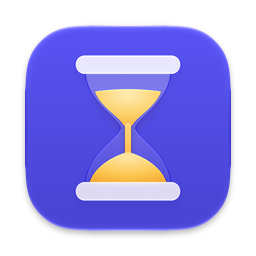
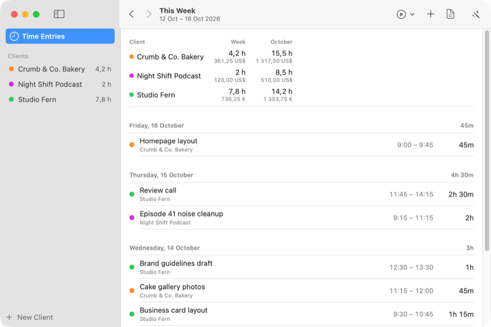

<p align="center"></p>

<h1 align="center">Hours</h1>

<p align="center">Tracks the hours you work for each client and turns them into an invoice.</p>

<p align="center"><a href="https://lamp.dev/?repo=https://github.com/lampdotdev/hours&amp;from=readme"></a></p>

<p align="center"><a href="#build-it-yourself">Build it yourself</a></p>

<p align="center"></p>

## Make Hours fit your work

Each opens Lamp with a copy of Hours and that change, ready to send:

- [Give invoices a classic letterhead look](https://lamp.dev/?repo=https://github.com/lampdotdev/hours&from=readme&ask=Give%20invoices%20a%20classic%20letterhead%20look)
- [Remind me if no timer runs](https://lamp.dev/?repo=https://github.com/lampdotdev/hours&from=readme&ask=Remind%20me%20if%20no%20timer%20runs)
- [Track mileage instead of hours](https://lamp.dev/?repo=https://github.com/lampdotdev/hours&from=readme&ask=Track%20mileage%20instead%20of%20hours)

## Open it in Lamp

[Lamp](https://lamp.dev) is a Mac app that builds apps from a description and changes them as you ask. [Open Hours in Lamp](https://lamp.dev/?repo=https://github.com/lampdotdev/hours&from=readme) for a copy of your own, to use and to change as you like, with the credits below kept. Or, in Lamp, choose File → Open from GitHub… and paste `https://github.com/lampdotdev/hours`.

## Build it yourself

With Apple's Command Line Tools installed (`xcode-select --install`):

```bash
./build.sh
```

The AI inside the app, and anything it does with other apps or devices, goes through Lamp, so those need Lamp open on the same Mac.

## License

MIT. See [LICENSE](LICENSE).
